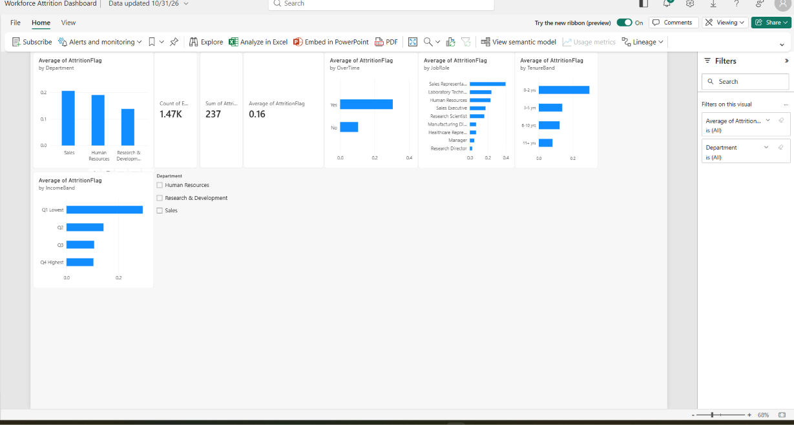

# Workforce Intelligence & Attrition Analysis

## Business problem
Employee attrition is costly: hiring, onboarding and lost productivity. HR teams need to know which employee groups are leaving at higher rates, so retention efforts can be targeted.

## Objectives
- Measure overall attrition and how it varies across departments, roles, demographics, pay, tenure, workload and satisfaction.
- Identify the highest-risk groups, with headcounts shown so rates can be judged fairly.
- Translate patterns into evidence-based HR recommendations.

## Dataset
IBM HR Analytics Employee Attrition & Performance (Kaggle): https://www.kaggle.com/datasets/pavansubhasht/ibm-hr-analytics-attrition-dataset
- 1,470 employees, 35 columns. License: [Database Contents License (DbCL) v1.0 (https://opendatacommons.org/licenses/dbcl/1-0/)]
- A fictional dataset created by IBM data scientists. Findings demonstrate analytical method, not facts about a real company.
- The raw data is not included in this repository; download it from the link above (see "How to reproduce").

## Tools
Python (pandas, matplotlib), SQL (SQLite), Power BI, Jupyter Notebook.

## Data preparation
- Checked for missing values (none), duplicate rows (none) and duplicate employee IDs (none).
- Removed EmployeeCount, Over18 and StandardHours (same value for all employees).
- Created a 1/0 attrition flag, plus age bands, tenure bands and income quartiles.

## Metric definition
Attrition share = employees with Attrition = "Yes" / total employees in the dataset. The data is a single snapshot with no dates, so an annual attrition rate cannot be calculated.

## Key findings
- Overall attrition share: 16.1% (237 of 1,470).
- Overtime: 30.5% attrition vs 10.4% without; the gap holds in every department.
- Early-career concentration: 29.8% at 0-2 years' tenure, 35.8% at ages 18-25, 26.3% at Job Level 1.
- Lowest income quartile: 29.3% vs about 10% in the top two quartiles.
- Highest-risk roles: Sales Representatives (39.8%, n=83), Laboratory Technicians (23.9%, n=259).
- Low environment satisfaction (25.4%), frequent business travel (24.9%) and no stock options (24.4%) are also associated with higher attrition.

## Dashboard

## Recommendations (to investigate, not proven fixes)
- Review overtime load, starting with Sales and junior roles.
- Strengthen the first two years of employment: onboarding, early check-ins, clearer progression from Job Level 1.
- Benchmark pay for the lowest income quartile and for Sales Representative and Laboratory Technician roles.
- Use satisfaction survey results as an early-warning signal.

## Limitations
- Synthetic data; no time dimension; no exit reasons.
- Associations, not causes. Several factors overlap (junior staff are younger, lower-paid and newer), so their separate effects can't be isolated with this analysis.
- Small groups (e.g. HR department, n=63) give unstable rates.
- Currency of MonthlyIncome is not stated in the dataset.

## Repository structure
- notebooks/01_data_inspection.ipynb: data quality checks
- notebooks/02_analysis.ipynb: cleaning, attrition analysis, charts
- notebooks/03_sql.ipynb: SQL queries
- sql/workforce_queries.sql: query file
- visualisations/: charts and dashboard screenshot

## How to reproduce
1. Install Python 3.13, then run: pip install -r requirements.txt
2. Download the CSV from the Kaggle link into data/raw/
3. Run the notebooks in order: 01, 02, 03.
